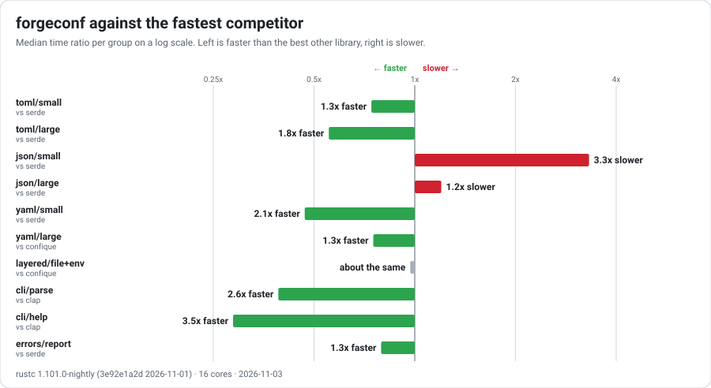
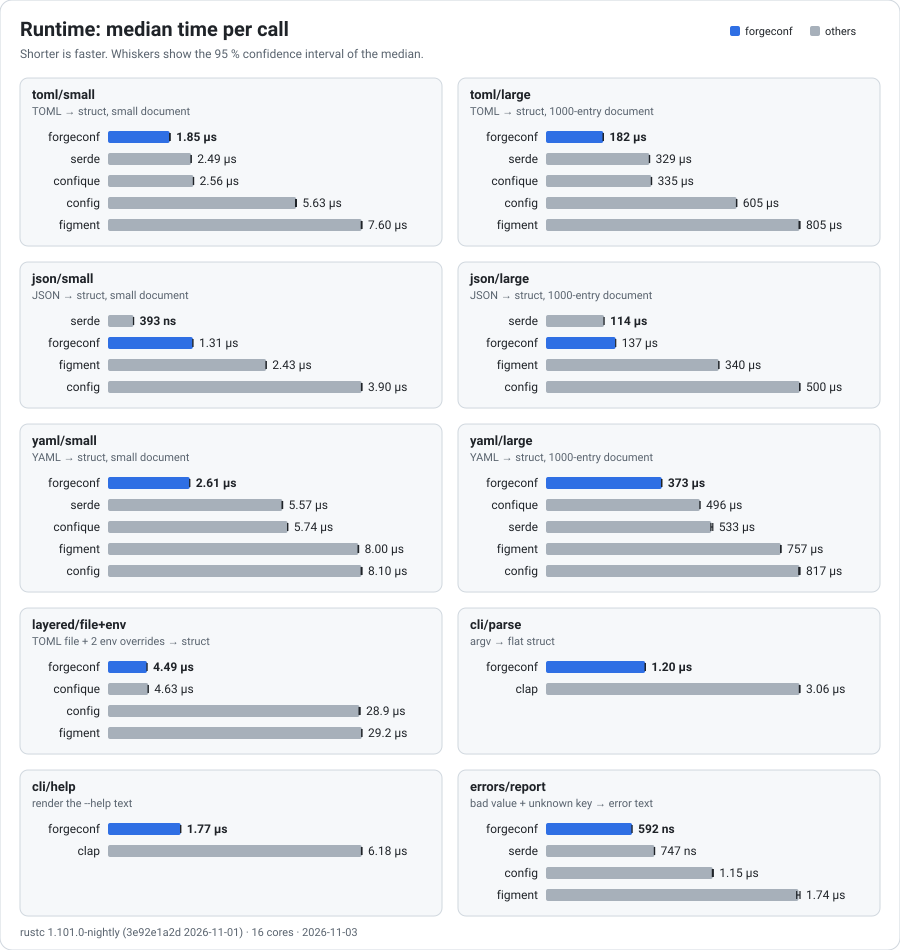
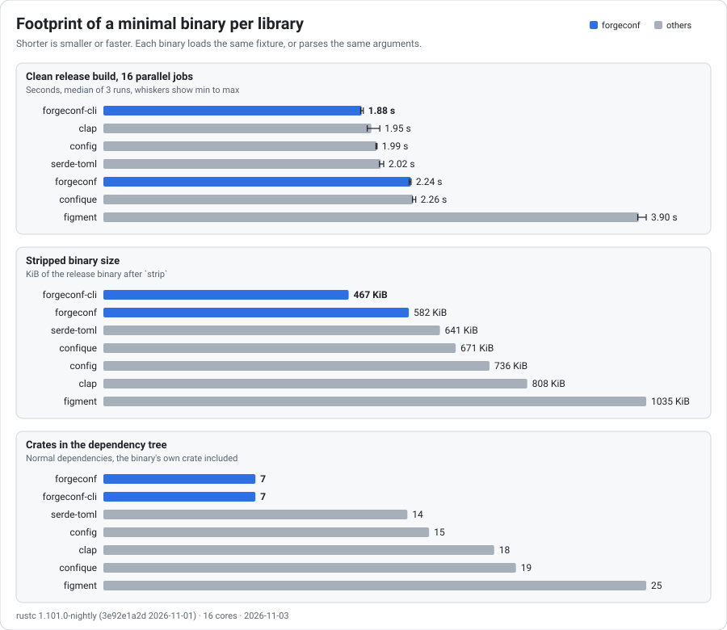
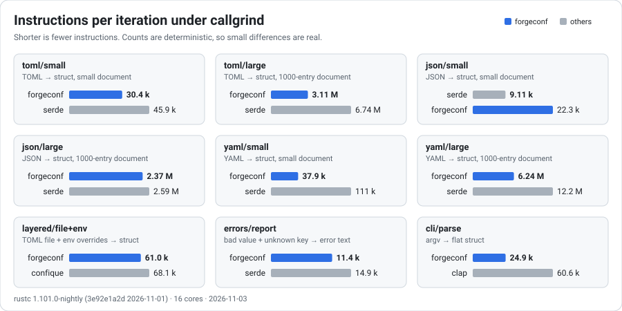

# Benchmarks

These benchmarks compare forgeconf with [config], [figment], [confique], plain serde ([toml], [serde_json], [serde_yaml]) and, for the command line, [clap].

This directory is a separate cargo workspace with its own `Cargo.lock`. It is never published, and the forgeconf workspace excludes it. Every competitor depends on serde, which forgeconf bans from its own dependency graph.

## Run

Inside `devenv shell`:

```sh
bench                      # runtime, footprint, then charts
bench runtime              # criterion benches only; arguments after -- go to criterion
bench footprint            # build time, binary size, crate count
bench instructions         # callgrind instructions per scenario (deterministic)
bench charts               # redraw images/*.svg from the latest results
FOOTPRINT_RUNS=5 bench footprint
CARGO_BUILD_JOBS=1 bench footprint   # total compile work instead of wall time
```

`bench charts` reads criterion's output in `target/criterion` and the files `bench footprint` and `bench instructions` write to `results/`, then writes the SVGs in `images/`. Commit the images after a measurement run.

`test-all benchmarks` builds every bench, runs each one once with its correctness checks, and verifies the footprint binaries without timing them.

## What is measured

All libraries load the same `AppConfig`: a name, a flag, a list, two nested tables and a map (`fixtures/app.toml`, `.json`, `.yaml`). The large documents add 1000 list entries and 1000 map entries.

| Group | Work in the timed region |
|---|---|
| `toml/*`, `json/*`, `yaml/*` | in-memory text to the typed struct |
| `layered/file+env` | read the TOML file from disk, apply two environment overrides, produce the struct |
| `cli/parse` | parse `--host 10.0.0.1 --port 9090 --debug --features a --features b` into a flat struct |
| `cli/help` | render the `--help` text |
| `errors/report` | load a document with a bad value and an unknown key, then format the error |

Every library's output is checked against the same expected value before any timing starts. A library that errors or returns the wrong data aborts the run, so it never reports a number.

The footprint crates (`footprint/*`) are minimal binaries that load the fixture file plus environment overrides, or parse the command line. Each one is built clean in release mode, stripped, and run to check its output.

## Results

Recorded on 2026-11-02 with rustc 1.101.0-nightly on a 16-core x86_64 Linux machine. The machine was not idle: load average was 2 to 4 from desktop processes, which is under the core count.

Versions (from `Cargo.lock`): config 0.15.27, figment 0.10.19, confique 0.4.0, serde 1.0.229, toml 1.1.8, serde_json 1.0.154, serde_yaml 0.9.34, clap 4.6.7, criterion 0.8.2.

### Runtime





Bars are criterion medians, and whiskers are their 95 % confidence intervals. Two full runs agreed within 4.7 % for forgeconf. The JSON and layered groups were repeated at low load (2.2 to 2.4) and agreed with the first runs within 5 %. Treat gaps under about 5 % as no measurable difference; the summary chart marks those "about the same".

### Footprint



With one build job instead of 16, the clean build time measures total compile work (median of three): forgeconf 4.6 s, forgeconf CLI-only 3.7 s, serde + toml 6.3 s, config 7.0 s, clap 7.5 s, confique 8.3 s, figment 16.0 s.

### Instructions



Instruction counts are exact and repeatable, which is why the performance work used them to accept or reject each change. They do not include memory stalls, so they can disagree with wall time: see JSON below.

## Reading the numbers

- **forgeconf is the fastest in every group except JSON.** `serde_json` deserializes straight into the struct and stays ahead: 0.39 µs against 1.31 µs on the small document, 114 µs against 137 µs on the large one. forgeconf builds an intermediate tree (now with short strings stored inline, so most values and keys no longer allocate), then moves it into the struct. On `json/large` callgrind counts fewer instructions for forgeconf than for serde_json (2.38 M against 2.60 M), yet serde_json is faster in wall time: building and walking the `BTreeMap` tree costs memory traffic and cache misses that an instruction count does not show [inference: no cycle-level profiler runs here]. Beating serde_json on JSON would need a direct typed parse path that skips the tree.
- **Layered loading is level with confique.** 4.49 µs against 4.63 µs is inside the run-to-run spread. About a quarter of forgeconf's work there is `getenv`: nine lookups, each scanning the whole environment. confique pays the same for the same nine variables.
- **Build time with 16 jobs.** It is nearly the same for everything except figment. Every library compiles `syn` for its derive macro, and that one crate is the longest chain [inference]. The one-job column shows the total compile work, where forgeconf needs about half of what the others need.
- **Errors.** forgeconf reports both problems (the bad value and the unknown key, each with a position). The serde-based libraries stop at the first one, so `errors/report` times more work for forgeconf, and forgeconf is still faster.
- **Where the speed came from.** Byte-wise scanning in every parser, building tables in bulk, an allocation-free environment walk, error text written straight into the formatter, moving values out of the parsed tree instead of cloning them, and the `Text` type, which stores strings of up to 22 bytes inline. Each change was kept only if `bench instructions` improved and no scenario regressed by more than 1 %.

## Known asymmetries

- **confique has no string loader.** In the `toml/*` and `yaml/*` groups, its layer is parsed by `toml` or `serde_yaml`, then passed to `builder().preloaded(...)`. confique also has no JSON support with the features used here, so it is absent from `json/*`.
- **Environment variable names differ.** config and figment use `APP_SERVER__PORT` (`__` separates nesting levels). forgeconf and confique use `APP_SERVER_PORT`. Each library uses its own documented convention, and all of them read the real process environment. confique has no prefix option, so it names a variable on each of the nine fields that forgeconf's `env_prefix` covers. An earlier version named only two, which made it look faster than it is.
- **`serde_yaml` is deprecated upstream.** It is still what figment uses for YAML.
- **Single machine.** Every result comes from one machine with a desktop running. Rerun `bench` on the target hardware before you rely on a close result.

[config]: https://crates.io/crates/config
[figment]: https://crates.io/crates/figment
[confique]: https://crates.io/crates/confique
[toml]: https://crates.io/crates/toml
[serde_json]: https://crates.io/crates/serde_json
[serde_yaml]: https://crates.io/crates/serde_yaml
[clap]: https://crates.io/crates/clap
